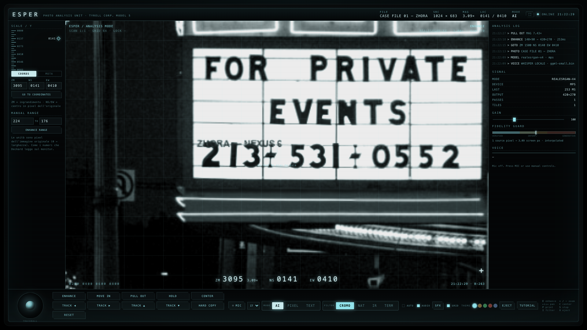
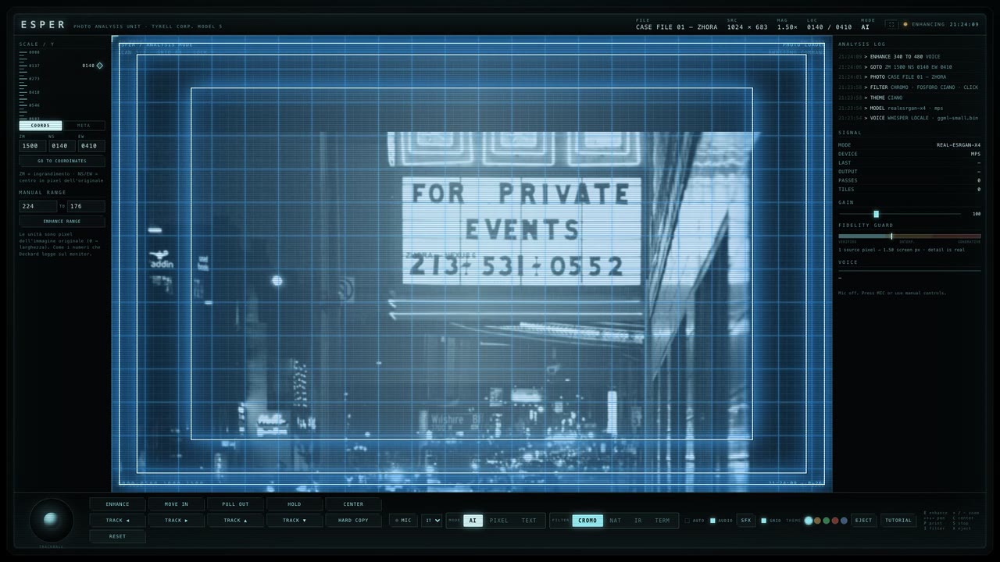
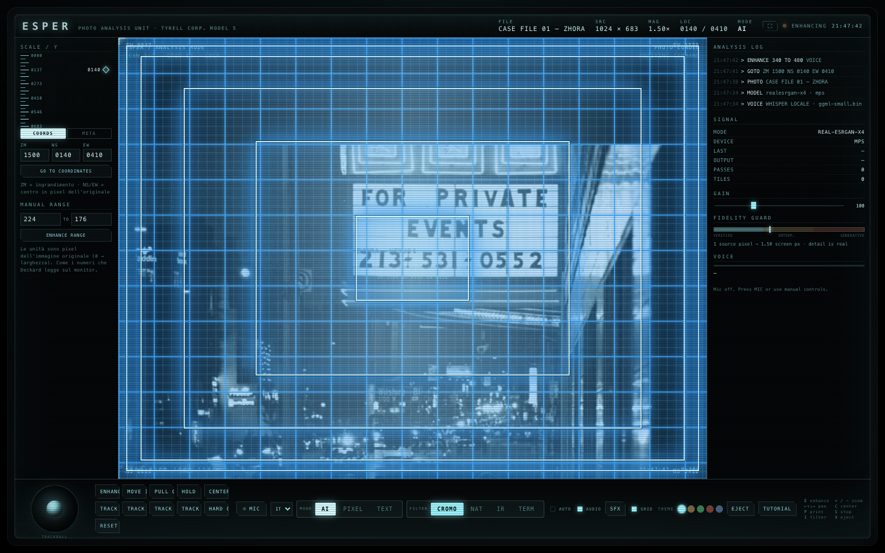
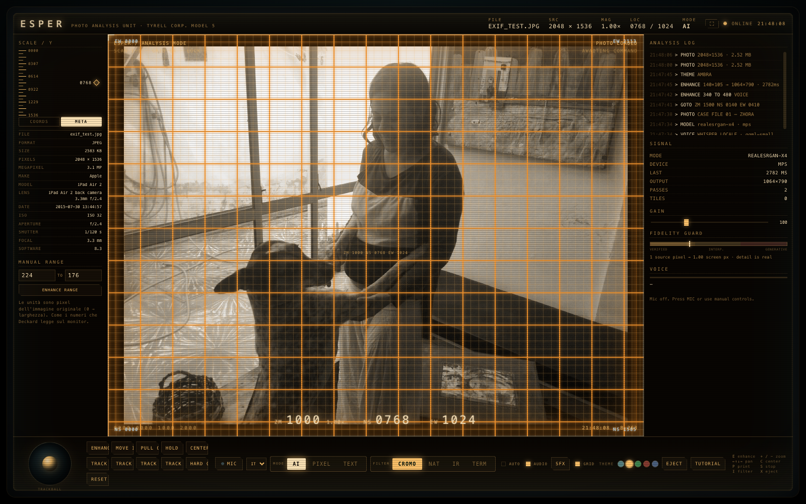

# ESPER — Photo Analysis Unit

*[English](README.md) · Italiano*

> «Enhance 224 to 176.»
> — Rick Deckard, *Blade Runner*, 1982

Ricostruzione funzionante della macchina **Esper** che Deckard usa nel suo appartamento
per analizzare la fotografia di Zhora. Nel film la scena comincia intorno al minuto
**1:20**: Harrison Ford inserisce un negativo, parla alla macchina e ingrandisce un
dettaglio fino a trovare una scaglia di serpente.

Qui quel gesto è reale: il "mirino" ingrandisce davvero, e i pixel che mancano vengono
ricostruiti da una rete neurale locale. **Nessuna immagine lascia il computer.**



[](docs/esper-intro.mp4)

*Sessanta secondi: la lastra entra, il mirino si muove, il modello ricostruisce,
le pellicole cambiano. Clicca l'immagine per vederlo.*

---

## In azione

**La sequenza di enhance.** Le coordinate sono pixel reali, il tunnel segna il
bersaglio, la griglia misura la lastra e la fascia in basso corre i numeri mentre
il modello lavora sul ritaglio originale.



**I metadati nella rail sinistra.** Gli EXIF si leggono dal file originale
all'inserimento, mai dalla copia ricostruita. Qui un fotogramma del 2015 su
fosforo ambra: il tema arriva fino all'ultimo pixel, la lastra resta intatta.



---

## Avvio

```bash
./start.command          # doppio clic anche da Finder
```

Apre il browser su `http://127.0.0.1:8777`. Il server resta in background;
per fermarlo:

```bash
pkill -f "python server.py"
```

Requisiti: macOS con Apple Silicon (testato su M5 Pro), Python 3.9+, ~250 MB di
dipendenze (PyTorch) e 64 MB di pesi del modello.

---

## Come si usa

1. **Inserisci una foto** — trascinala nella finestra, `OPEN FILE`, oppure
   `CASE FILE 01` per il caso dimostrativo (una foto notturna CC0 con un dettaglio
   inciso: la targa si trova intorno a **x 340–480, y 126**).
2. **Inquadra** con il mouse (trascina = pan, rotella = zoom) o con la trackball in
   basso a sinistra, che si comporta come quella fisica del film.
3. **ENHANCE** — ricostruisce la regione con Real-ESRGAN x4. Ogni passata è vera
   super-resolution, non un ingrandimento interpolato.
4. **HARD COPY** — esporta un PNG con la cornice e i metadati, come la stampa che
   Deckard chiede alla macchina.

### Comandi vocali

Premi **MIC** (serve Chrome o Safari; il riconoscimento di Chrome richiede rete) e
parla. Funzionano in inglese e in italiano.

| Comando | Italiano | Effetto |
|---|---|---|
| `Enhance` | *migliora / ingrandisci* | ricostruisce la regione del mirino |
| `Enhance 224 to 176` | *migliora da 224 a 176* | ricostruisce la fascia x=176…224 |
| `Move in` | *avvicina* | zoom avanti |
| `Pull out` / `Pull back` | *allontana* | zoom indietro |
| `Track 45 right` | *sposta a destra* | pan del 45% dello schermo |
| `Go right` … `Stop` | *vai a destra … fermati* | pan continuo, poi stop |
| `Center` | *centra* | ricentra la vista |
| `Hard copy` | *stampa* | esporta il PNG |
| `Hold` / *zoom continuo* / *continuous zoom* | *continua* | zoom continuo finché non dici `stop` |
| `Hold in` / `Hold out` | — | zoom continuo avanti / indietro |
| `Reset` | *azzera* | pulisce i tile ricostruiti |
| `Eject` | *espelli / cambia foto* | toglie la lastra e torna all'inserimento |

Le coordinate sbagliate **non vengono più corrette in silenzio**: una fascia
fuori dalla lastra (`0…larghezza`) o più stretta di 2 px fa suonare il suono
d'errore e scrive il motivo nel log. Un numero sbagliato ma valido (175 invece di
176) non è distinguibile — la macchina esegue ciò che ha sentito, e il log mostra
la fascia usata.

Il parser accetta anche i numeri a parole, nella forma militare del film:
*"enhance two hundred twenty four to one seventy six"* → `224 → 176`.

### Suoni

Gli effetti **non sono sintetizzati**: sono ritagliati dalla traccia audio della
scena originale. `extract_sfx.py` cerca i transienti brevi a banda larga
(click meccanici) tra 0:50 e 1:55, ne trova 253, li ritaglia e salva uno
spettrogramma per ciascuno; `build_sfx.py` sceglie i quattro più puliti e li
normalizza.

| File | Nel film | Uso nella GUI |
|---|---|---|
| `select.wav` | click secco (t≈1:30) | conferma comandi, track, center, coordinate |
| `zoom.wav` | click corposo (t≈1:34) | MOVE IN / PULL OUT, risultato dell'enhance |
| `enhance.wav` | click + coda (t≈1:35) | avvio dell'elaborazione |
| `shutter.wav` | due scatti a 75 ms (t≈1:48) | HARD COPY, come l'otturatore + avanzamento |
| `paper.wav` | fruscio di carta (t≈0:55) | quando la fotografia viene inserita |
| `hum.wav` | 8 s di ambiente stazionario, in loop | ronzio continuo della macchina |
| `fault.wav` | click rallentato e cupo | quando l'analisi fallisce |

Il pulsante **SFX** nella console li fa ascoltare in sequenza. La casella
`AUDIO` è attiva di default; i browser sbloccano l'audio solo dopo il primo
click (è una regola loro, non una scelta della macchina).

Nota onesta: sotto i click c'è la partitura di Vangelis. Il passa-alto a 550 Hz
e la selezione dei transienti a banda larga riducono il sanguinamento, ma non
lo eliminano del tutto. I 14 candidati grezzi restano in
`audio_raw/candidates/` se vuoi cambiarne uno.

### Comandi manuali (senza microfono)

Tutti i comandi vocali hanno un pulsante. In più:

* **COORDINATE ENTRY** — `ZM` (ingrandimento, 1000 = vestibilità schermo),
  `NS`/`EW` (centro in pixel dell'immagine originale). `GO TO COORDINATES`.
* **MANUAL RANGE** — `A → B` in pixel: ricostruisce esattamente quella fascia,
  come `Enhance 224 to 176`.
* **Trackball** trascinabile, **rotella** per lo zoom, **doppio clic** per
  ricostruire un punto.
* Tastiera: `E` enhance · `+/-` zoom · frecce pan · `C` center · `P` print ·
  `S` stop · `F` fit · `X` eject.

---

## La macchina, sotto il cofano

```
static/            GUI (HTML/CSS/JS, nessun framework)
static/audio/      i quattro effetti (WAV 16-bit mono)
extract_sfx.py     trova e ritaglia i transienti dalla scena
build_sfx.py       compone select / zoom / enhance / shutter
server.py          FastAPI: upload, preview, enhance, cache dei tile
esper_engine.py    RRDBNet (Real-ESRGAN x4) con tiling, su MPS
make_demo.py       genera il caso 01 con il dettaglio inciso
models/            RealESRGAN_x4plus.pth (64 MB)
```

* **Modello**: Real-ESRGAN `x4plus` — RRDBNet a 23 blocchi, 16,7 M parametri,
  licenza BSD. Gira su **Metal (MPS)**: ~0,6 s per un crop 320×200, ~1,8 s per
  un enhance a 5× con due passate.
* **Tiling**: crop grandi vengono processati a blocchi di 192 px con 16 px di
  sovrapposizione, così non si vedono cuciture.
* **Sorgente**: ogni enhance parte **sempre dall'originale**, mai dal risultato
  precedente. È la regola dell'alchimista: si trasmuta il minerale, non il residuo.
* **Cache**: i tile già calcolati sono riusati (hash di rettangolo + fattore).
* **Fallback**: senza PyTorch o senza pesi, il sistema passa a Lanczos + unsharp
  e lo dichiara (`MODE: CLASSIC`) invece di fingere.

### Il tunnel, la griglia, il tempo

Tre dettagli presi dal monitor del film (visibili a **2:48**):

* **Griglia di coordinate** — quando l'immagine è ferma, per ~4 s si accende una
  griglia blu più definita (`#4aa8ff`) con le coordinate ai quattro angoli;
  poi torna al livello tenue.
* **Tunnel di rettangoli** — all'ordine di `ENHANCE` compaiono cinque riquadri
  concentrici che si accendono **in sequenza dal più grande al più piccolo**, uno
  ogni 240 ms, e **restano accesi**: il tunnel si costruisce sotto gli occhi.
  Ogni accensione suona come il `PULL OUT`. Solo alla fine il tunnel si dissolve
  in blocco, e allora parte lo zoom.
* **Coordinate grandi** — `ZM · NS · EW` in grande al centro-basso, come sul
  monitor: spariscono durante l'elaborazione e tornano a fine lavoro.

Il tunnel non è decorazione: **copre la latenza**. La richiesta all'IA parte
insieme al primo rettangolo, quindi per i primi 4× (≈0,4 s) il risultato è
pronto prima che l'animazione finisca e l'utente non vede mai la barra di
attesa. Se la macchina è più lenta, solo allora appare il pannello `ENHANCING`.

**Prefetch**: appena un enhance è concluso, il client chiede in silenzio il
livello successivo (centro al 55%, fattore ×2) e lo tiene pronto. Se il comando
successivo cade dentro quell'area, il tile è già in memoria e lo zoom è
istantaneo.

### Il modello: Remacri (e perché non x4plus)

Il motore accetta qualsiasi checkpoint ESRGAN x4: stessa architettura RRDBNet,
nomi dei tensori diversi. Ne ho provati tre sullo stesso crop, con giudizio in
cieco su due prove (la scritta `SONY` di 85×41 px e un dettaglio metallico):

| modello | testo | dettaglio | esito |
|---|---|---|---|
| `RealESRGAN_x4plus` | legge **OONY** (la S si chiude) | credibile ma morbido | ripiego |
| `4x-UltraSharp` | S corretta, ma aloni | texture rumorosa, ringing | no |
| `4x_foolhardy_Remacri` | **S corretta**, aloni minimi | credibile, naturale | **default** |

Effetti concreti: la `S` di `SONY` resta una `S` in **AI pura**, senza passare
da TEXT, e l'enhance scende da ~640 ms a **141 ms** su MPS.

I checkpoint community usano i nomi Basicsr (`model.0`, `model.1.sub.N.RDBx…`).
Il loader li rimappa per posizione **dopo** aver verificato che tutte le 702
forme coincidano: se non coincidono, errore esplicito invece di un'immagine
sbagliata. Per forzarne un altro: `ESPER_MODEL=/percorso/modello.pth`.

Nota che costa un'ora se non la si sa: la chiave della cache dei tile include
il nome del modello. Senza, il primo enhance dopo il cambio restituisce il PNG
del modello precedente (`meta.cache_hit: true`, `passes: 0`) e sembra che il
nuovo modello non funzioni.

### La voce è locale: whisper.cpp

Il riconoscimento non passa più dal cloud. `whisper-cli` (Homebrew) con
`ggml-small.bin` (465 MB) trascrive **sul Mac**, in 0,3–0,4 s per una frase
breve (6 s il primo giro, che paga il caricamento del modello).

Il flusso è tutto locale:

```
MediaRecorder (browser) → /api/voice (ffmpeg 16 kHz mono) → whisper-cli → handleCommand
```

Il browser registra a segmenti con un **VAD** sull'`AnalyserNode`: quando l'RMS
supera 0,018 il segmento è "parlato", quando scende sotto per 650 ms si chiude
e si invia. Un segmento deve anche aver toccato un picco di 0,03 e durare almeno
600 ms: sotto quella soglia è rumore di fondo, e whisper sul rumore **inventa**
frasi (sottotitoli, ringraziamenti). Le allucinazioni note vengono scartate prima
del parser. Un segmento muto viene scartato dopo 12 s (niente buffer che
cresce), uno troppo lungo chiuso a 9 s. Il pulsante MIC ora accende questo
circuito, non la Web Speech API.

Niente prompt di biasing: **misurato**, su frasi brevi whisper prova a
completarlo e allucina (*«E' un'altra venace»* per «enhance»). Il lavoro lo fa il
vocabolario fonetico a valle, che conosce anche le forme storpiate — whisper
sente «enhance» come *«in ance»*, e quella forma è nel dizionario.

Sostituire il modello è una variabile d'ambiente: `WHISPER_MODEL=…/ggml-medium.bin`
(più lento, più preciso). Binario: `WHISPER_BIN` se non è nel PATH.

### La voce: sinonimi e tolleranza agli errori

Il recognizer non restituisce quasi mai le parole esatte: `enhance` diventa
`hands`, `track left` diventa `tracklist`, `avvicina` diventa `avicina`. Il
parser non pretende più la frase perfetta. Tre strati:

1. **Dizionario fonetico** (`PHONETIC`) sulle parole che il recognizer sbaglia
   sempre, applicato prima del parsing.
2. **Sinonimi** (`VOICE_SIMPLE`): ogni comando ha 4–8 modi di essere detto,
   inglese e italiano — `avvicina`, `più grande`, `zoomin`, `move in`.
3. **Similarità di Levenshtein** su parole intere: `avicina` → `avvicina` (88%),
   `stampami` → `stampa` (87%). Soglia 0.85 per i comandi di una parola, 0.74
   per le frasi; le parole corte hanno una penalità, così `up` non batte
   `pull out`.

Il recognizer offre **6 interpretazioni** per enunciato: se ne prova una alla
volta finché una produce un comando. Il readout mostra cosa ha capito e con
quanta confidenza (`AVICINA → MOVE IN · 88%`).

**Il limite da sapere:** la Web Speech API non è locale. Chrome manda l'audio
ai suoi server per la trascrizione (Safari usa la dettatura di sistema). Le
foto non escono dal Mac, ma la voce sì. Per un riconoscimento davvero offline
serve `whisper.cpp` con un modello locale.

### La rail a schede: coordinate o metadati

La colonna sinistra ha due schede. **COORDS** è la macchina (ZM/NS/EW, GO TO,
MANUAL RANGE). **META** è la pellicola: file, formato, peso, pixel, megapixel,
poi make/model/lens, data, ISO, apertura, tempo, focale, software, GPS.

Gli EXIF si leggono **dal file originale** nel server (`_exif_dict`), non
dall'immagine già convertita in RGB: la conversione e la trasposizione possono
lasciare l'oggetto senza tag. Se la foto non ne ha — schermata, PNG, frame
sintetico — la scheda lo dice: `EXIF · none — synthetic or stripped frame`,
invece di mostrare righe vuote che sembrano un guasto.

### Full screen: solo il monitor

Il pulsante `⛶` nella barra alta porta `#viewport` in fullscreen — non `#screen`,
che contiene anche le rail. Resta **solo la lastra**, con i suoi overlay
(griglia, mirino, coordinate), e il pan/zoom continua a funzionare: il cambio di
dimensioni rifà il clamp su un frame successivo. `ESC` esce.

### Cinque temi del fosforo

Il **vetro** ha cinque tinte, il selettore è una fila di pallini nella barra
bassa, il tasto `T` le cicla e si possono dire: «tema ambra», «tema verde»,
«tema rosso», «tema blu», «tema ciano».

| tema | riferimento |
|---|---|
| **CIANO** | il monitor del film (default) |
| **AMBRA** | fosforo P3, terminali anni '70 |
| **VERDE** | VT100 |
| **ROSSO** | sala di controllo |
| **BLU** | IBM retro |

Il tema cambia testo, bordi, griglia, glow, trackball e **tinta della lastra**
(il filtro CROMO segue il vetro): è un solo attributo su `<html>`, perché il CSS
non contiene più colori cablati — 89 `rgba` sono diventati `var(--fos-rgb)`.
La scelta resta in `localStorage` e sopravvive al ricaricamento.

### Quattro lastre: CROMO, NATURALE, INFRAROSSO, TERMICO

Il monitor non mostra la foto: la **interpreta**. Quattro rese, scelte dai
pulsanti `FILTER`, dal tasto `I` (cicla) o a voce (`filter infrared`,
`filtro naturale`, `termico`, `cromo`).

| filtro | come è fatto |
|---|---|
| **CROMO** | `grayscale(1)` + velo `rgba(120,238,255,.16)` in `mix-blend-mode: color` — il fosforo del film, default |
| **NATURALE** | nessun `grayscale`, velo spento: i colori veri, solo gain e contrasto |
| **INFRAROSSO** | filtro SVG `feColorMatrix` **IRG**: il verde (clorofilla che riflette il NIR) va nel rosso, il rosso visibile nel blu, e il blu viene sottratto dal rosso. Vegetazione rossa, cielo freddo |
| **TERMICO** | `feColorMatrix saturate(0)` + `feComponentTransfer` con tabella `blu → magenta → rosso → giallo → bianco`, preceduta da una stirata di gamma (`slope 1.45, intercept -0.22`) |

Perché SVG e non solo CSS: `hue-rotate` ruota la tinta ma non **rimappa i
canali**, e il termico richiede una funzione non lineare. Le due matrici sono
in `index.html` (`#f-ir`, `#f-thermal`) e agiscono anche sui **tile** enhanced,
perché `#base` e `#tiles img` leggono la stessa variabile `--f-img`. Il velo
ciano è una variabile separata (`--tint-fill`, `--tint-op`): nei filtri diversi
da CROMO si spegne, altrimenti tingerebbe di ciano anche l'infrarosso.

La **lastra non sopravvive al reload**: si riparte sempre da CROMO, così nessun
filtro può accendersi «da solo» senza che tu lo abbia scelto. (Il *tema* invece
si ricorda, perché è una preferenza di ambiente, non uno stato di analisi.)

### Cache: mai più una GUI vecchia su un motore nuovo

Il server invia `Cache-Control: no-store` su `/` e `/static/*`. Senza, capita
esattamente questo: l'HTML nuovo mostra i pulsanti `AI/PIXEL/TEXT`, il browser
tiene in cache il `esper.js` **vecchio**, che non invia il campo `text` — e
l'enhance finisce in AI mentre il pulsante dice TEXT. Sintomo indistinguibile da
un bug di stato. Verifica: `curl -D - http://127.0.0.1:8777/static/js/esper.js`.

Il pannello `SIGNAL` dichiara inoltre la modalità **all'inizio** dell'enhance
(`TEXT-TTA` / `REAL-ESRGAN-X4`), non alla fine: prima mostrava il valore
precedente e sembrava che la macchina fosse passata ad AI durante il lavoro.

### TEXT: quando la lettera conta

Real-ESRGAN è addestrato sulle immagini naturali, non sui caratteri. Su una
scritta di dieci pixel la `S` chiusa viene riletta come `O` o `D`: il modello non
recupera, **decide**, e decide male. La modalità `TEXT` fa due cose prima e
durante l'enhance:

1. **Pre-contrasto** (`autocontrast` + `unsharp` leggero): riporta il tratto alla
   sua dinamica, così la curva della S non si appiattisce in un anello.
2. **TTA orizzontale**: enhance dell'originale + enhance dello specchiato, poi
   media. Le due passate sbagliano in modo diverso, la media li costringe a
   convergere. Il flip **verticale** è escluso: il testo non è simmetrico in
   verticale e il modello ha visto meno lettere capovolte.

Costo: **due passate da 4× invece di una da 8×** — misurato 963 ms contro 899 ms,
praticamente gratis. Il tunnel da 1,7 s lo copre del tutto.

Misura sul caso reale (scritta `SONY` su una scatola, 85×41 px):

| modalità | OCR Vision | lettura in cieco |
|---|---|---|
| AI (baseline) | `XHOO` 0.30 | **DONY** |
| TEXT (pre+TTA) | `SOWY` 1.00 | **SONY** |

L'OCR locale (`experiments/ocr.swift`, framework Vision) serve solo come giudice
grossolano: su dettagli così piccoli sbaglia anche lui. La conferma vera è la
lettura in cieco ripetuta, più la verifica a occhio nella GUI.

### HOLD: lo zoom che non si ferma da solo

Nel film Deckard dice *"Move in"* e poi *"Stop"*: il movimento **continua** finché
non lo interrompi. `MOVE IN` resta lo scatto con enhance; `HOLD` (pulsante, tasto
`H`, o comando vocale *"hold" / "continua"*) avvia lo zoom continuo.

L'ancora è un **pixel reale**: si prende il punto sotto il mirino in coordinate
native e lo si tiene fermo mentre la scala cresce (raddoppia ogni secondo), così
il dettaglio non scivola via. Il readout mostra entrambe le letture: `ZM 3014`
(formato del film, 1000 = 1×) e `3.01×` (il fattore vero). Si arresta con
`STOP`, al limite di 40×, o quando la foto finisce.

*"Hold out"* / *Shift+H* fa la stessa cosa al contrario.

### Cosa abbiamo preso da esperjs

Della [emulazione React del 2019](https://github.com/gboyegadada/esperjs) — oggi
ferma, 1 stella, zoom CSS senza enhance — abbiamo importato solo il **design
dell'interazione vocale**, che era più maturo del nostro:

* **Quattro alternative** per ogni riconoscimento (`maxAlternatives = 4`): si
  prova ogni interpretazione finché una produce un comando valido.
* **Normalizzazione fonetica** (`PHONETIC`): il recognizer sbaglia sempre le
  stesse parole — *hands* per `enhance`, *tracklist* per `track left`, *pool* per
  `pull`, *centor* per `center`. Ventitré correzioni prima del parser.
* **`go back`**: inverte l'ultima mossa (cronologia di 40 stati).
* **Grammatica JSGF** dichiarata al recognizer (Safari la usa, Chrome la ignora).

Non presi: i beep sintetici (noi abbiamo i suoni del film), lo zoom su
`background-position` e le coordinate astratte 0–200.

### Due modi di guardare: AI e PIXEL

Il selettore `AI / PIXEL` nella console cambia la natura dell'enhance.

* **AI** — Real-ESRGAN ricostruisce; oltre 4× inventa, e il `+` a destra lo
  segnala come livello "enhanced" (come il segno sul monitor del film).
* **PIXEL** — il modello resta spento. Lo zoom mostra **i pixel reali**
  (`image-rendering: pixelated`), senza interpolazione né sintesi: il dettaglio
  è squadrato, granuloso, come nel 1982. Il Fidelity Guard dichiara
  `REAL PIXELS — no model, no invention`.

L'idea viene dal [progetto Esper per norns](https://llllllll.co/t/esper/67885)
di notester, che tratta l'immagine come una gerarchia di blocchi: `these are the
actual pixels of the image down here`. È la critica più onesta al nostro uso
dell'IA, e il film le dà ragione — Deckard non vede superfici levigate, vede
grana.

### Fidelity guard

La barra a destra dichiara sempre a che punto siamo:

| Ingrandimento | Stato | Significato |
|---|---|---|
| ≤ 2× | VERIFIED | il dettaglio è reale, nessuna invenzione |
| 2–4× | INTERPOLATED | ricostruzione plausibile |
| > 4× | GENERATIVE | il modello **sta inventando** texture |

Nel film Deckard spinge oltre ogni limite fisico. Qui il limite è dichiarato:
oltre un certo punto non si recupera informazione, si produce una ipotesi
verosimile. La targa del caso 01 è leggibile a 4–6× proprio perché l'inchiostro
c'era ancora; a 16× la rete comincia a "leggere" ciò che vuole.

---

## Note tecniche

* `torch==2.2.2` è l'ultima build compatibile con Python 3.9 su macOS ARM;
  richiede **NumPy < 2** (altrimenti `_ARRAY_API not found`).
* Il modello si carica una volta sola all'avvio (~1,5 s) e resta in memoria.
* Le foto più grandi di 6000 px vengono ridotte all'ingresso; se ne tengono in
  memoria al massimo 4.
* Il riconoscimento vocale usa la Web Speech API del browser: Chrome invia
  l'audio al proprio servizio, Safari è più riservato ma meno preciso. I comandi
  manuali funzionano sempre, anche offline.

---

## Crediti

* Scena e comandi: *Blade Runner* (1982), regia di Ridley Scott, soggetto di
  Philip K. Dick. Ricostruzione amatoriale, senza alcun affiliazione.
* Super-resolution: [Real-ESRGAN](https://github.com/xinntao/Real-ESRGAN) di
  Xintao Wang et al. (BSD-3-Clause).
* Foto del caso 01: *Pedestrians Walking on Neon Lit Urban City Street*, **CC0**,
  via Openverse/Flickr. Il dettaglio inciso è stato aggiunto per questo progetto.
