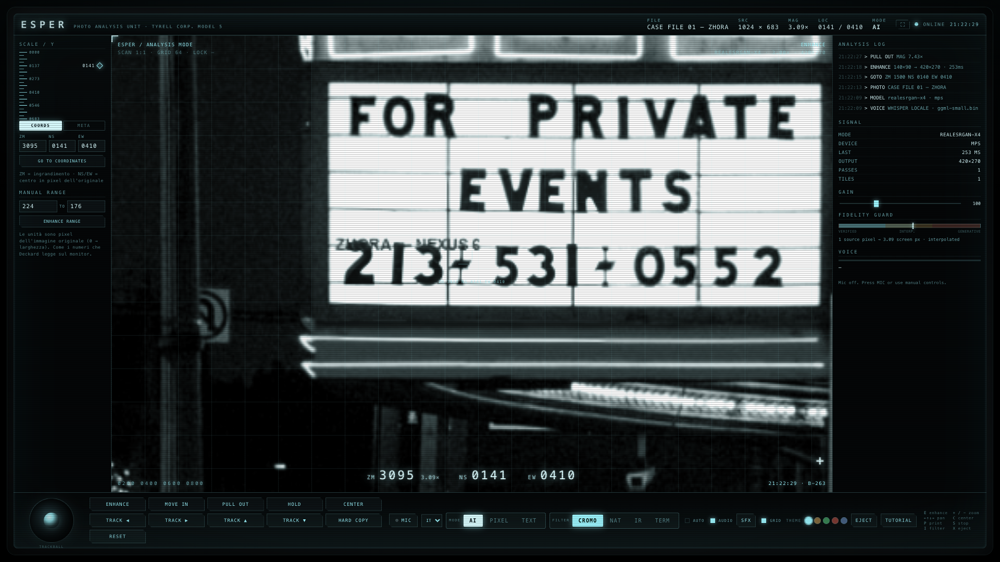
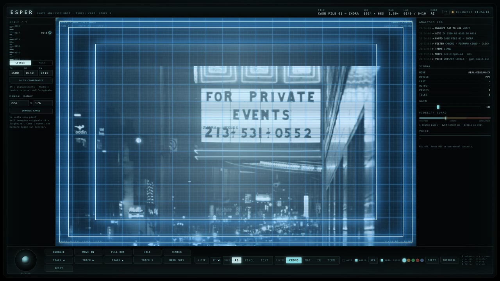
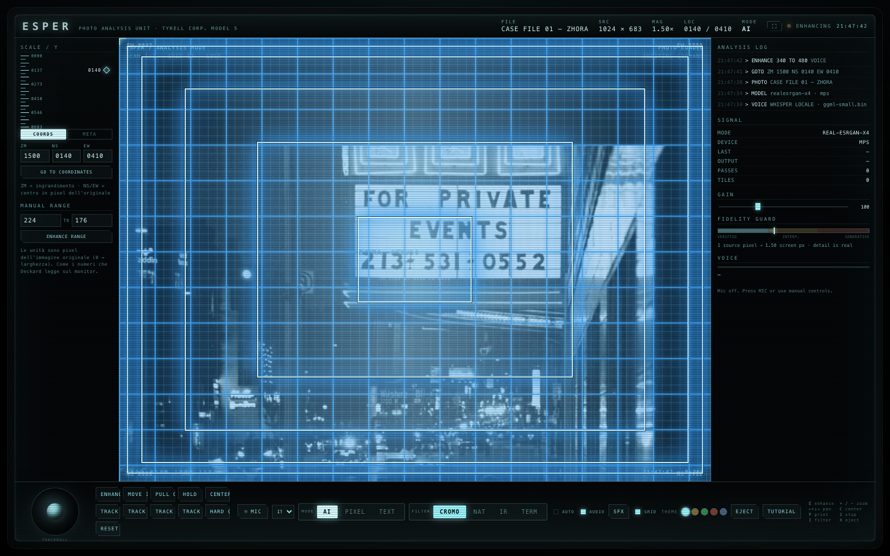
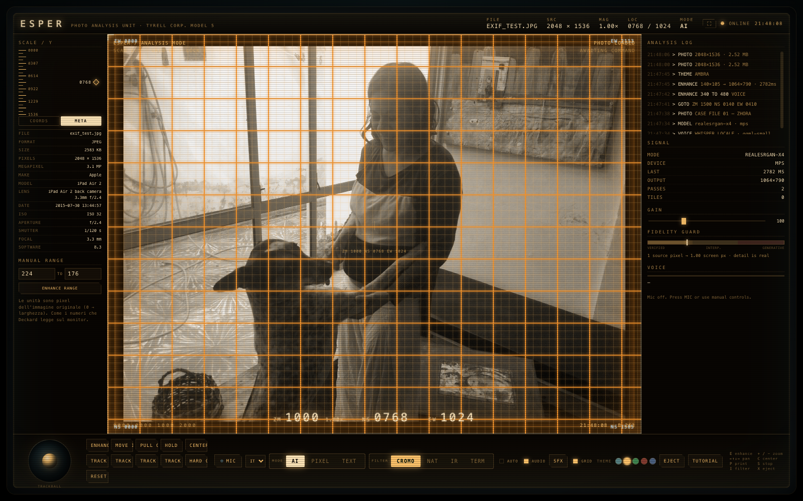

# ESPER — Photo Analysis Unit

*English · [Italiano](README.it.md)*

> "Enhance 224 to 176."
> — Rick Deckard, *Blade Runner*, 1982

A working reconstruction of the **Esper** machine Deckard uses in his apartment to
analyse the photograph of Zhora. In the film the scene starts around **1:20**:
Harrison Ford feeds a negative into the machine, talks to it, and magnifies a detail
until he finds a snake scale.

Here that gesture is real. The viewfinder actually magnifies, and the pixels that
are missing are reconstructed by a local neural network. **No image and no audio
leaves the Mac.**



[](docs/esper-intro.mp4)

*Sixty seconds: the frame goes in, the viewfinder moves, the model reconstructs,
the plates change. Click the picture to play.*

---

## In action

**The enhance sequence.** Coordinates are real pixels, the tunnel marks the target,
the grid measures the plate, and the lower band runs the numbers while the model
works on the original crop.



**Metadata in the left rail.** EXIF is read from the original file when it is
inserted — never from the enhanced copy. Here a 2015 iPad frame on the amber
phosphor: the theme reaches every pixel, the plate itself stays untouched.



---

## Highlights

- **Real super-resolution**, not interpolation — RRDBNet (Real-ESRGAN architecture)
  running on Apple Metal via PyTorch MPS.
- **Three render modes** — `AI` (neural), `PIXEL` (raw pixels, model off), `TEXT`
  (character-safe reconstruction).
- **Four plates** — `CROMO` (cyan phosphor, default), `NATURAL`, `INFRA-RED`
  (IRG false colour), `THERMAL` (heat map), built on real SVG colour matrices.
- **Local voice control** — `whisper.cpp` + MediaRecorder, English and Italian,
  with fuzzy matching that tolerates the recognizer's mistakes.
- **EXIF reader** — file, camera, lens, date, ISO, aperture, shutter, focal, GPS,
  shown in the left rail next to the coordinate entry.
- **Operator card** — a one-page quick reference in English, one keystroke away.
- **Full-screen monitor**, fidelity guard, coordinate grid, and an exported PNG
  "hard copy" with frame and metadata.

---

## Quick start

```bash
./start.command
```

It opens the browser on `http://127.0.0.1:8777`. The server stays in the
background; to stop it:

```bash
pkill -f "server.py"
```

Full setup from scratch — Python packages, Homebrew tools, model weights — is in
**[REQUIREMENTS.md](REQUIREMENTS.md)**.

---

## Platforms

| Platform | Status |
|---|---|
| **macOS, Apple Silicon** | **fully tested** — Metal (MPS) |
| Linux, NVIDIA GPU | supported — CUDA, same code, `./start.sh` |
| Windows, NVIDIA GPU | supported — CUDA, `start.bat` |
| Linux / Windows, CPU only | supported — `ESPER_DEVICE=cpu`, slower |

The engine picks `mps → cuda → cpu` by itself; `ESPER_DEVICE` forces the choice.
Platform-specific setup is in **[REQUIREMENTS.md §10](REQUIREMENTS.md)**. The
non-macOS paths have not been exercised on real hardware yet — the CPU branch has
(315 ms for an 85×41 crop, same result as Metal).

---

## Using it

1. **Insert a photo** — drag it onto the window, press `OPEN FILE`, or `CASE FILE 01`
   for the demo case (a CC0 night photo with an engraved plate around
   `x 340–480, y 126`).
2. **Aim** with the mouse (drag = pan, wheel = zoom), the trackball at the bottom
   left, or the coordinate entry (`ZM`/`NS`/`EW`).
3. **ENHANCE** — reconstructs the region under the reticle. Every pass is true
   super-resolution, and the HUD tells you the honest factor: up to 2× is real,
   2–4× interpolated, beyond 4× generated. A `+` mark means you are looking at a
   synthesised level.
4. **HARD COPY** — exports a PNG with the frame and metadata.

### Mouse and keyboard

| Input | Action |
|---|---|
| drag | pan (trackball) |
| wheel | zoom at cursor |
| click / double-click | select / reconstruct a point |
| `E` | enhance |
| `+` / `−` | zoom in / out |
| arrows | pan |
| `C` | center |
| `P` | hard copy |
| `H` | hold — continuous zoom |
| `S` | stop |
| `F` | fit to screen |
| `I` | cycle plate |
| `X` | eject the frame |
| `ESC` | close the operator card / exit full screen |

### Voice

Press **MIC** and speak. Recognition runs **locally** on `whisper.cpp`: the browser
records short segments, a VAD closes them after ~650 ms of silence (trigger
threshold 0.018 RMS, peak 0.03, minimum 600 ms — below that it is room noise, and
whisper invents text on noise), and the server transcribes them. English and Italian are selected by the `EN/IT` dropdown.

| Say | Italian | Effect |
|---|---|---|
| `enhance` | *analizza / migliora* | reconstruct the reticle region |
| `enhance 224 to 176` | *migliora da 224 a 176* | reconstruct the x=176…224 band |
| `move in` | *avvicina* | zoom in |
| `pull out` | *allontana* | zoom out |
| `track 45 right` | *sposta a destra* | pan |
| `hold` / `zoom continuo` / `continuous zoom` | *continua* / *fermati* | keep zooming until `stop` |
| `hold in` / `hold out` | *continua avanti / indietro* | keep zooming in / out |
| `center` | *centra* | recenter |
| `hard copy` | *stampa / salva* | export PNG |
| `filter infrared` | *metti infrarosso* | switch plate |
| `reset` | *azzera* | clear reconstructed tiles |
| `eject` | *espelli / cambia foto* | remove the frame, back to insert |
| `tutorial` | *aiuto / manuale* | open the operator card |

Wrong ranges are **refused, not clamped**: a band outside `0…width`, or narrower
than 2 px, plays the fault sound and logs the reason — otherwise a typo would
silently produce a plausible crop you never asked for. A number that is wrong but
still valid (175 instead of 176) cannot be detected: the machine executes what it
heard, and the log shows the range it used.

The parser accepts spoken numbers in the film's military form
(*"enhance two hundred twenty four to one seventy six"*), synonyms in both
languages, and near-misses: `avicina` still resolves to `move in` at 88%. The
readout shows what it heard and how confident it is.

---

## Render modes

| Mode | What it does |
|---|---|
| `AI` | neural super-resolution; invents plausible detail beyond 4× |
| `PIXEL` | turns the model off and shows the real pixels |
| `TEXT` | pre-contrast + horizontal TTA, tuned for characters rather than texture |

## Phosphor themes

Five glass tints: **cyan** (the film), **amber** (P3 phosphor), **green**
(VT100), **red** (control room), **blue** (retro IBM). Pick one from the dots in
the bottom bar, press `T` to cycle, or say *"theme amber"* / *"tema verde"*.

The theme repaints text, borders, grid, glow, the trackball and the plate tint —
one attribute on `<html>`, because the stylesheet no longer holds any hard-coded
colour (89 `rgba()` calls became `var(--fos-rgb)`). The choice persists in
`localStorage`.

## Plates

| Plate | Look |
|---|---|
| `CROMO` | cyan phosphor, the film's monitor (default) |
| `NATURAL` | true colour, no tint |
| `IR` | near-infrared false colour — vegetation red, sky cold |
| `THERMAL` | heat map — blue, magenta, red, yellow, white |

The plate applies to the base image **and** to the reconstructed tiles, so a tile is
never a different colour from the rest of the photograph.

The plate **always resets to CROMO on load** — it is analysis state, not a
preference, and a remembered filter is a filter that can switch on without you.

---

## Under the hood

```
server.py            FastAPI: static GUI, upload, enhance, EXIF, voice
esper_engine.py      RRDBNet + tiled inference on MPS (Metal)
static/index.html    the machine: top bar, rails, deck, console
static/css/esper.css CRT styling, plates, operator card
static/js/esper.js   viewport, tile cache, commands, voice, rail
models/              network weights (not versioned)
start.command        launcher
```

### Super-resolution

The default model is **`4x_foolhardy_Remacri`**, chosen by blind A/B on the two
hardest cases: the word `SONY` at 85×41 px and a brushed-metal detail.

| Model | Text | Detail | Verdict |
|---|---|---|---|
| `RealESRGAN_x4plus` | reads **OONY** (the S closes) | credible but soft | fallback |
| `4x-UltraSharp` | correct S, but halos | noisy, over-sharpened | rejected |
| **`4x_foolhardy_Remacri`** | **correct S**, minimal halos | **credible, natural** | **default** |

On M5 Pro / MPS an 85×41 crop becomes 340×164 in **~141 ms**. Override the model
with `ESPER_MODEL=/path/to/model.pth`. `esper_engine.py` accepts any ESRGAN x4
checkpoint, including the Basicsr-named ones (`model.N.*`), because it remaps
tensors **by position only after verifying that all 702 shapes match**.

### Tiling

192 px tiles with 16 px overlap, so there are no visible seams. `MAX_OUT` caps the
output side at 2400 px; `MAX_PASSES` at 2, beyond which it would be pure
invention. `torch.mps.empty_cache()` after each job brings allocation back from
gigabytes to tens of megabytes.

### Voice

```
MediaRecorder (browser) → POST /api/voice → ffmpeg 16 kHz mono → whisper-cli → parser
```

`ggml-small.bin` (465 MB) transcribes a short sentence in **0.3–0.5 s** (measured
339–478 ms across runs); the first call takes ~6 s while the model is mapped. There is no biasing prompt: measured, whisper tries to
complete it on short phrases and hallucinates. The phonetic layer downstream does
the work — whisper hears "enhance" as *"in ance"*, and that form is in the
dictionary. The parser then applies three
layers: a phonetic dictionary for words the recognizer always gets wrong
(`hands → enhance`), synonyms in both languages, and Levenshtein similarity on
whole words (threshold 0.85 for single-word commands, 0.74 for phrases).

### API

| Method | Path | Purpose |
|---|---|---|
| `GET` | `/api/status` | engine state, device, model, whisper availability |
| `POST` | `/api/photo` | upload an image (multipart `file`) → id, size, EXIF |
| `POST` | `/api/voice` | transcribe audio (multipart `audio`, query `lang`) |
| `POST` | `/api/enhance` | `{id, x, y, w, h, out_w, text?}` → PNG data URL + meta |
| `GET` | `/api/photo/{id}/preview.jpg` | downscaled preview for the viewport |
| `GET` | `/api/photo/{id}/native` | the stored original |
| `GET` | `/api/photo/{id}/info` | size and metadata |
| `POST` | `/api/demo` | load the demo case |
| `GET` | `/` | the GUI |

---

## Privacy

- The **upscaler** is local: weights on disk, forward pass on the GPU. No network.
- The **voice** is local: `whisper.cpp` on the same Mac. No audio leaves it.
- The only network activity is the **one-time download of the model weights**
  (see REQUIREMENTS.md). The server never downloads anything at runtime.
- `static/` is served with `Cache-Control: no-store` so a reload always shows the
  code you just wrote.

---

## Troubleshooting

| Symptom | Cause / fix |
|---|---|
| `address already in use` | another server on 8777: `pkill -f "server.py"` |
| The GUI shows old code | hard reload `⌘⇧R`; the server already sends `no-store` |
| `Failed to initialize NumPy` | NumPy 2 installed: `pip install "numpy==1.26.4"` |
| `MODE: CLASSIC` / model not loaded | weights missing or unreadable: check `models/` |
| `/api/voice` returns 503 | `whisper-cli` or the model is missing: see REQUIREMENTS.md |
| Microphone does not open | browser permission: System Settings → Privacy → Microphone |
| Enhance is slow on big crops | expected: tiling keeps it linear, 600×400 takes ~2.3 s |

---

## Credits

- *Blade Runner* (1982) — the Esper scene, and the line.
- [Real-ESRGAN](https://github.com/xinntao/Real-ESRGAN) — RRDBNet architecture.
- `4x_foolhardy_Remacri` (Foolhardy) — default weights.
- [whisper.cpp](https://github.com/ggml-org/whisper.cpp) — local transcription.
- [esperjs](https://github.com/ThibaultBee/esperjs) — design reference for the
  voice interaction; the implementation here is independent.

Italian notes and the full development log live in [README.it.md](README.it.md)
and [docs/ESPER_NOTES.md](docs/ESPER_NOTES.md).
